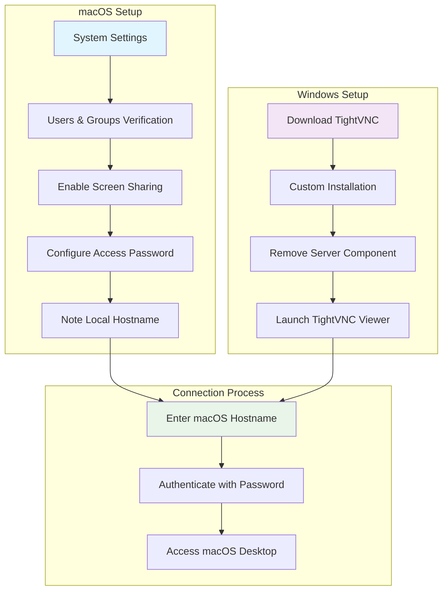

# Access Your Mac Remotely from Windows Using TightVNC

A comprehensive guide for setting up secure remote desktop access from Windows to macOS using TightVNC. This tutorial provides step-by-step instructions with visual aids to help you establish a reliable remote connection.

## Table of Contents

- [Overview](#overview)
- [Prerequisites](#prerequisites)
- [System Architecture](#system-architecture)
- [Setup Instructions](#setup-instructions)
  - [Part 1: macOS Configuration](#part-1-macos-configuration)
  - [Part 2: Windows Client Setup](#part-2-windows-client-setup)
  - [Part 3: Establishing Connection](#part-3-establishing-connection)

## Overview

This guide demonstrates how to enable remote desktop access to your macOS machine from a Windows computer using TightVNC. The setup involves configuring macOS's built-in screen sharing feature and connecting through TightVNC Viewer on Windows.

## Prerequisites

**macOS Requirements:**
- macOS 10.14 (Mojave) or later
- Administrator privileges
- Network connectivity

**Windows Requirements:**
- Windows 10 or later
- TightVNC Viewer (provided in guide)
- Network access to the macOS machine

## System Architecture

## Setup Instructions

### Part 1: macOS Configuration

#### Step 1: Access System Settings

Navigate to **System Settings** from the Apple menu or Spotlight search.

#### Step 2: Verify Current User Account

Open **Users & Groups** to confirm the current user account that will be used for remote access.

#### Step 3: Navigate to Sharing Settings

Go to **General** → **Sharing** to access network sharing options.

#### Step 4: Record Local Hostname

**Important:** Note the **Local Hostname** displayed at the bottom of the sharing panel. This identifier will be used to establish the connection from Windows.

#### Step 5: Enable Screen Sharing

Toggle **Screen Sharing** to **ON** and set a secure password for VNC access. This password will be required when connecting from the Windows client.

### Part 2: Windows Client Setup

#### Step 6: Download TightVNC

Search for **TightVNC** in your preferred web browser to access the official download page.

#### Step 7: Select Appropriate Version

Download the TightVNC installer that matches your Windows system architecture (32-bit or 64-bit).

#### Step 8: Choose Custom Installation

During the installation process, select **Custom Setup** to customize the installation components.

#### Step 9: Remove Server Component

**Important:** Remove the **TightVNC Server** feature from the installation. We only need the viewer component for connecting to macOS.

#### Step 10: Complete Installation

Verify the server component removal (indicated by the cross mark) and proceed with the installation.

### Part 3: Establishing Connection

#### Step 11: Launch TightVNC Viewer

Search for and launch **TightVNC Viewer** from the Windows Start menu.

#### Step 12: Enter Connection Details

In the **Remote Host** field, enter the macOS local hostname noted in Step 4, then click **Connect**.

#### Step 13: Authenticate

Enter the screen sharing password configured in Step 5.

#### Step 14: macOS Login

You will see the macOS login screen. Enter your macOS user account credentials.

#### Step 15: Successful Connection

You now have remote access to your macOS desktop from Windows!

## License

This documentation is provided under the MIT License. See the LICENSE file for details.
